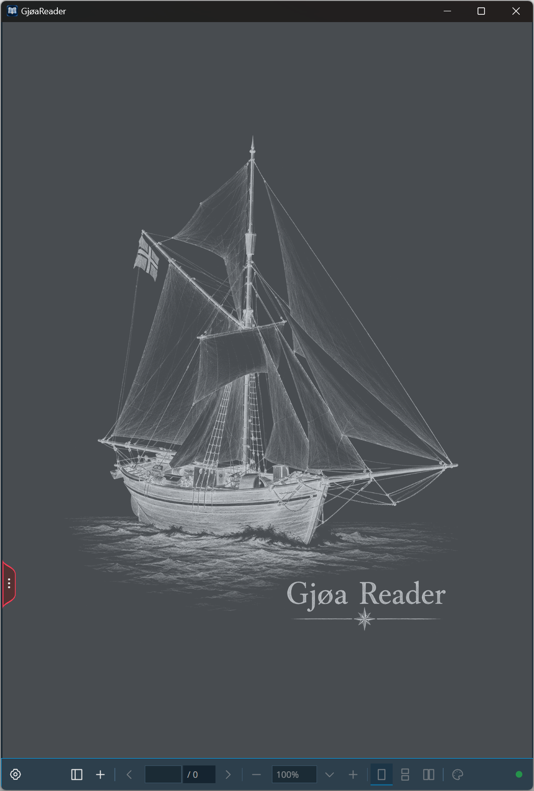
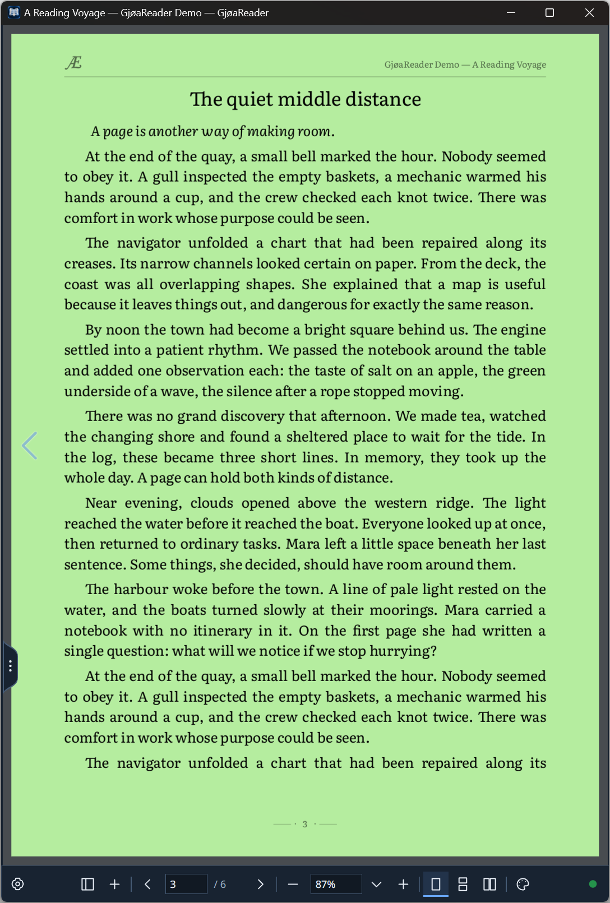
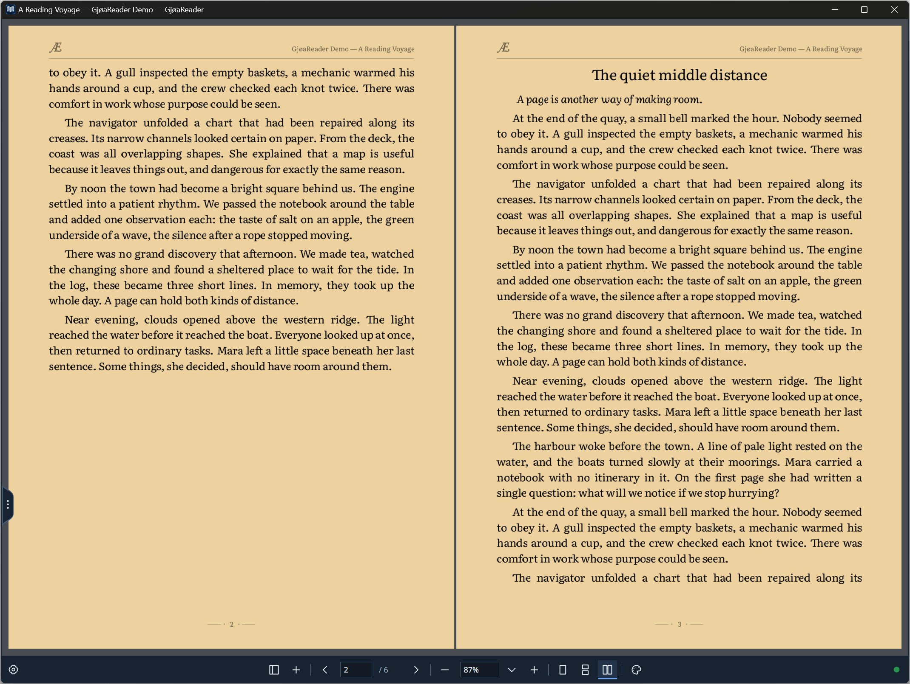
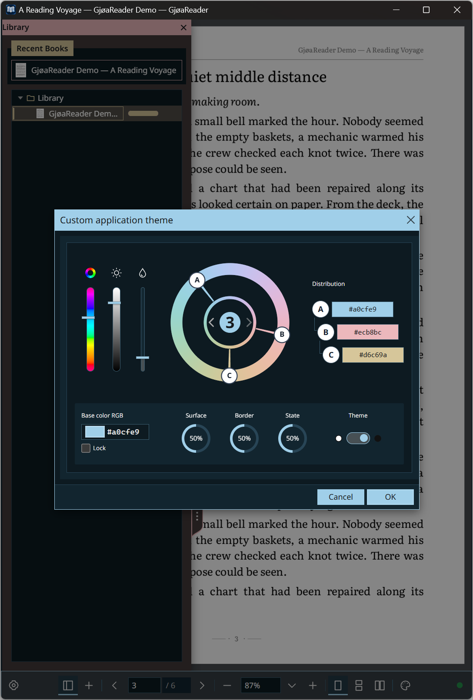

# GjøaReader

A local Windows desktop reader with a Rust publishing/rendering engine and a [Tæt UI](https://github.com/edward-ap/taet-ui) shell. Text books are typeset once into saved pages; fixed-layout documents keep their original page geometry. Reading does not require Node.js, a development server or a network connection.

**Supported formats:** FB2, EPUB, MOBI (MOBI6), DjVu, PDF, RTF, CBZ and CBR; Markdown is also supported. See [format details and limits](#formats-and-platform).



The start screen has no book open. The reading screenshots below show *A Reading Voyage*, original synthetic demonstration prose included as [a sample FB2](demo/A%20Reading%20Voyage.fb2), with customized application and page colors. [Screenshot details and provenance](docs/SCREENSHOTS.md).

## Reading

- Import one or several books with the **+** button, **Browse files**, or drag-and-drop inside **Import Books**. Each file has its own progress and Reading/Processing/Saving status. Close the dialog after the queue settles, then double-click a Library item to read it.
- Choose **Single Page**, **Facing Pages**, or **Continuous Pages** in the bottom bar. Use the arrows, page-number field, zoom controls and fit options to navigate.
- Organize Library items into folders and return through Recent Books. Reading positions and page annotations persist between launches.
- Open the local **Painter** annotation tools from the palette button to draw, underline and add text over a page. See [Page annotations](#page-annotations) for tools and storage.
- **Settings** controls the application theme, workspace and supported page colors. UI themes do not filter book pages. The current interface is English.
- **Ctrl+O** opens an external document; **Ctrl+G** focuses the page-number field. Library imports copy their sources into owned storage, so opening an imported item does not depend on its original external file.



Single Page, showing page 3 of *A Reading Voyage* on custom green paper.



Facing Pages, showing pages 2 and 3 of the same demonstration book on custom tan paper.

## Page annotations

The local [Painter](docs/PAINTER.md) draws over the page: freehand pen strokes, solid or dashed lines for underlining, arrows, rectangles and squares, ellipses and circles, and plain-text notes. Press the palette button, then expand the edge tab to choose a tool or color. You can select, move and erase annotations; drawings use page coordinates and stay aligned when zooming. Underlining is drawn manually, rather than attached to a text selection.

Annotations save automatically for each book/edition and page in `annotations.sqlite` inside this application's data/profile directory, separately from its Library source and saved edition files. These notes are available in the reader after reopening. They **do not modify the original book or embed notes in FB2, EPUB, PDF, DjVu or other original formats**; sharing the original book does not include them. The current application interface has no command to export annotations or an annotated book. Painter's developer `exportJSON()` API serializes its annotation model; it is not a book-format exporter.

## Custom colors

Open **Settings → Application Theme → Custom**, then press **Custom** to create or edit your palette with the built-in **Tæt ThemeDesigner**. Choose a light or dark foundation, edit the base RGB color, hue, saturation and lightness, and arrange up to **three color anchors** on the harmony wheel. **Surface**, **Border** and **State** adjust surface tint, border contrast and interaction-state intensity with live application preview.

Confirm **OK** in the editor and again in Settings to save the theme; **Cancel** discards the draft. Page and workspace colors have their own controls.



The custom-theme editor supports coordinated palettes, including the pastel blue, pink and yellow accents shown here.

## Page appearance and fixed layout

Application themes color the controls; they do not filter book pages. The workspace background around the pages accepts a custom RGB color. Page paper has a separate color control, enabled when the open document supports it: generated text editions recolor paper and text, and DjVu provides paper adjustment. Original PDF pages and CBR/CBZ image pages retain their source colors and layout; embedded illustrations in generated editions also keep their own colors. DjVu paper adjustment can tint color scans and illustrations.

There is no reading-font selector. Text formats are typeset into saved pages using the application's publishing typography at import. Zooming or resizing changes their display scale and raster resolution, **without reflowing text or repaginating**. Fixed-layout documents also keep their page geometry. This keeps page drawings and saved text/link geometry in the same logical coordinates; zoom is not a font-size or typography setting.

## Formats and platform

| Format | Reading behavior and current boundary |
| --- | --- |
| DjVu / DjV | Original fixed pages, with the existing page-paper adjustment. |
| PDF | Original PDFium-rendered pages. Password entry and PDF reflow are not provided. |
| CBR | JPEG/PNG pages from a single-volume, unencrypted RAR archive, extracted once into a saved image edition. |
| CBZ | Image-based ZIP comics, JPEG/PNG/WebP/BMP pages, extracted once into a saved image edition. |
| FB2 | Canonical saved text pages, including supported tables, images and notes. |
| EPUB | Semantic content uses Reader typography; publisher CSS, fonts and geometry are not reproduced. |
| RTF | Saved text pages with supported formatting, images and notes. |
| MOBI | Unencrypted MOBI6, including the MOBI6 part of dual editions, with uncompressed or PalmDOC text. Standalone KF8/AZW3, HUFF/CDIC compression and DRM are unsupported. |
| Markdown | UTF-8 .md/.markdown with saved semantic layout; linked network resources are not fetched. Arbitrary text files are not treated as Markdown. |

The currently validated target is **Windows x64 (MSVC)**. The bundled PDFium is Windows x64; Linux, macOS, ARM and mobile application builds are not provided or validated by this project. The presence of cross-platform Tauri icon assets does not establish those ports. Original PDF and comic-image page colors remain unchanged; generated text pages and DjVu support the existing page-appearance controls.

CBR extraction uses statically linked native UnRAR; no separate WinRAR or unrar executable is required. PDF rendering uses the bundled Windows x64 PDFium library. DRM-protected books are unsupported; EPUB encrypted/obfuscated resources and encrypted CBZ members are rejected.

Validation is narrower than the format list: the current migration's automated standalone WebView2 smoke exercised generated FB2, EPUB, PDF and JPEG-backed DjVu fixtures. Synthetic Rust tests cover MOBI, RTF and CBZ parsing/publication. An additional automated standalone check imported one user-authorized, unencrypted, single-volume RAR-based CBR containing 194 JPEG pages stored without additional RAR compression. All saved page ordering and CRCs were checked, four pages were displayed, and the Library item and reading position were restored after restart. Solid archives, RAR5 and other RAR compression methods were not exercised by this check. These are automated checks, not a manual certification of every variant or a successful run of the ignored external book corpus.

## Run the Windows release

Download the Windows x64 ZIP from [GitHub Releases](https://github.com/edward-ap/gjoa-reader/releases/latest), extract it into a regular writable folder and run **GjøaReader.exe**. Keep the accompanying notices and covered-source files together with the executable. The ZIP has no installer and does not include books or a user profile.

The application needs the **Microsoft Edge WebView2 Evergreen Runtime** and **Microsoft Visual C++ v14 Redistributable (x64)**. Install them from Microsoft's official [WebView2 download page](https://developer.microsoft.com/en-us/microsoft-edge/webview2/) and [Visual C++ Redistributable page](https://learn.microsoft.com/en-us/cpp/windows/latest-supported-vc-redist). The executable directly imports MSVCP140.dll from the C++ runtime; no separate PDF viewer, WinRAR, Node.js or Rust installation is needed for reading. Prerequisite installation may require network access; the reader itself runs offline afterwards.

The release was exercised on Windows 11 x64. No clean Windows VM, older Windows version, physical pen/IME or other operating system is certified by these checks. This is an unsigned standalone build.

## Build from source

Prerequisites: stable Rust for x86_64-pc-windows-msvc, Microsoft C++ Build Tools with Desktop development with C++ and the Windows SDK, Node.js 22+ with npm, and WebView2 Evergreen. See the official [Tauri Windows prerequisites](https://v2.tauri.app/start/prerequisites/#windows). Microsoft Edge is additionally used by the browser test suite. The application itself uses WebView2, not an npm-installed browser.

Validated tool versions are Rust 1.96.0 and Node.js 22.14.0. These are observed versions, not a promise of a fully tested minimum Rust version. Unicode checkout paths are supported; the Windows build and tests were exercised from a path containing **ø (U+00F8)**.

From the repository root:

```powershell
npm ci
npm run taet:verify
npm run build
npm run desktop:build
& '.\src-tauri\target\release\GjøaReader.exe'
```

The Tauri build emits the standalone named executable at src-tauri/target/release/GjøaReader.exe. No installer, signing or publication is performed. For the named debug executable:

```powershell
npm run desktop:build -- --debug
& '.\src-tauri\target\debug\GjøaReader.exe'
```

The technical Cargo package/library remain reader. Raw Cargo builds and tauri dev may use that technical target name; Tauri build applies mainBinaryName. Builds own dist and native target outputs. Close any working-project executable before relinking it. Debug native code is optimized to keep publication practical, while its existing assertions/debug information remain enabled.

## Data and safe validation

Normal launches use this application's Tauri app-data directory, with identifier **local.gjoa.reader**. Existing Library items, preferences and saved editions remain independent of the executable filename. The application does not look up another reader's data. Source imports and generated editions are immutable; opening an installed text edition reads saved pages rather than parsing or typesetting the original again.

For an isolated manual launch, choose a separate absolute directory outside the checkout in a new PowerShell session:

```powershell
$env:READER_TEST_DATA_DIR = 'C:\Temp\GjoaReader-manual'
$env:WEBVIEW2_USER_DATA_FOLDER = "$env:READER_TEST_DATA_DIR\webview"
& '.\src-tauri\target\release\GjøaReader.exe'
```

The override isolates Library, preferences, annotations, font cache and window state. Do not point it at real app data. Use a fresh shell for a later normal launch, or clear those process-only overrides first. See [native boundaries](docs/NATIVE_BOUNDARIES.md).

Source checks:

```powershell
npm run test:types
npm test
Set-Location src-tauri
cargo fmt --check
cargo clippy --all-targets --locked -- -D warnings
cargo test --locked
Set-Location ..
```

After all commands that can relink native executables have finished, run native suites sequentially, each with an external evidence directory:

```powershell
npm run test:native:release -- 'C:\Temp\GjoaReader-smoke'
npm run test:native:formats -- 'C:\Temp\GjoaReader-formats'
```

These launch the real standalone WebView2 app using new isolated profiles and generated books. The basic smoke covers publication/raster pages, view modes and exact annotation/resume restoration after restart. The formats smoke covers synthetic FB2/EPUB/PDF/JPEG-backed DjVu, a malformed-file queue error, custom theme persistence and restart. Browser file/pointer injection is automated coverage, not physical pen/touch/IME or native file-dialog certification. Screenshots/logs stay outside source except reviewed README images. Run npm run screenshots:readme with an external directory to reproduce demo captures.

Default tests use synthetic/generated fixtures. Thirteen legacy external-corpus tests are intentionally ignored and require an explicitly authorized GJOA_TEST_CORPUS_DIR; they are not successful corpus coverage. Tæt remains a pre-1.0 release candidate, with Grid/TreeGrid and Advanced marked experimental upstream. Windows results do not certify WebKit or other operating systems.

## UI delivery and local extensions

Published **Tæt UI v0.6.0-rc.4**, Git commit **bfd3ddcddf1cdc539397e5d2ac5ed3cb976e72c2**, is vendored from its exact npm archive. Published SHA-512 archive integrity and selected-file SHA-256 values are pinned in vendor/taet-ui/pin.json. No sibling framework checkout or runtime npm resolution is required. The upstream package has no runtime dependencies.

```powershell
npm run taet:verify
npm run taet:fetch
# Explicit reviewed published update: matching version tag and full Git commit.
node scripts/vendor-taet-ui.mjs --pin vVERSION FULL_COMMIT_SHA
```

All public import aliases share one compiled all/foundation ESM instance, with matching CSS, WOFF2 and notices. The upstream dui-* classes, data-dui-* attributes, --dui-* tokens and backward-compatible data identifiers are intentionally retained. They are not a second framework runtime.

- [RenderViewport](docs/VIEWPORT.md) is a local raster extension with its own geometry/types/styles and cancellation/bitmap ownership. It does not import Painter.
- [Painter](docs/PAINTER.md) is the independent local SVG annotation extension. The saved **DenseUI.Painter v1** codec name is preserved so existing annotations remain readable.
- ThemeDesigner and ThemeApplicator come from Tæt. The [application contracts](docs/APP_CONTRACTS.md) retain hosts, cache, palette, Library commands, theme draft and native bridge ownership.
- [Dependency provenance](docs/DEPENDENCIES.md) explains the pin and extension origin. No decoder, typography, Library storage or raster IPC belongs to the UI library.

## License and distribution

Original application code, documentation, synthetic demonstration prose in the capture script and demo FB2, and project-owned artwork are **MIT**, copyright 2026 Edward Aponasko; see [LICENSE](LICENSE). This grant does not replace upstream UI/extension, decoder, font, schema or native-library terms. The full executable must not be described as MIT-only.

- [License scope](docs/LICENSE_SCOPE.md) and [third-party notices](THIRD_PARTY_NOTICES.md).
- [Fonts/assets/native notices](licenses/ASSETS.md) and [project artwork](licenses/ARTWORK.md).
- [Rust dependency notices](licenses/RUST_DEPENDENCIES.md), [MPL source availability](licenses/SOURCE_AVAILABILITY.md) and [development tools](licenses/DEVELOPMENT_TOOLS.md).

Keep required notices and covered-source availability materials alongside any future binary distribution:

```powershell
node scripts/package-notices.mjs --out 'C:\Temp\GjoaReader-notices'
```

The destination must be new/empty and outside source. This prepares accompanying notices/source archives only, without app/tool binaries or font/artwork payloads. The pinned FB2 schema set retains its repository-wide BSD-2-Clause license; its exact text and provenance are included with the notice bundle. Build commands do not publish a repository or release.
